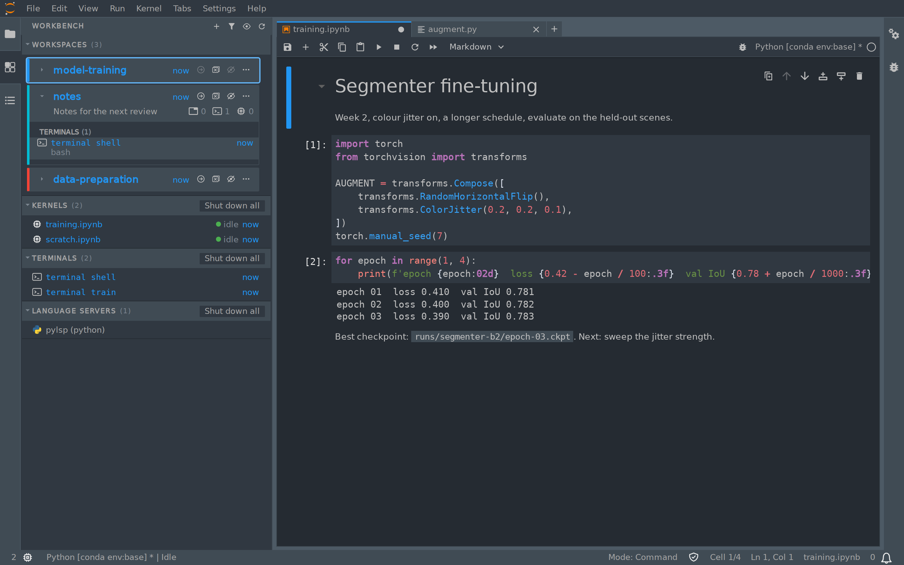

# Workspace panel for JupyterLab

[](https://github.com/stellarshenson/jupyterlab_workspace_manager_extension/actions/workflows/build.yml)
[](https://www.npmjs.com/package/jupyterlab_workspace_manager_extension)
[](https://pypi.org/project/jupyterlab-workspace-manager-extension/)
[](https://pepy.tech/project/jupyterlab-workspace-manager-extension)
[](https://jupyterlab.readthedocs.io/en/stable/)
[](https://kolomolo.com)
[](https://www.paypal.com/donate/?hosted_button_id=B4KPBJDLLXTSA)

This extension replaces the built-in Running Terminals and Kernels sidebar with a panel organised by workspace: a WORKSPACES section with one card per workspace, then KERNELS, TERMINALS and LANGUAGE SERVERS sections listing everything that runs, each section opening and closing on its own.



_Fig 1 - The workspace panel beside a notebook of the workspace this window shows_

## Why a workspace panel

Developers and data scientists now run several projects at once: they start an agent on one project and work on another while it runs. Each project holds its own tabs, terminals and kernels in a JupyterLab workspace, and the built-in Running panel lists all of them in one flat list, so a terminal from one project sits beside a kernel from another with nothing to tell them apart.

The panel groups them by workspace: what each project holds, what is running in it, and how long ago it was used, with one click to switch to it.

## Features

- **Workspace section** - the colour strip, the name and the age, and the purpose with the number of tabs, terminals and kernels while the card is open
- **Triangle** - opens or closes a section
- **Header** - a click on the name of another workspace switches this window to it, and a click on this window's workspace opens its card or closes it
- **Menu** - open, open in a new browser tab, close all tabs, set description, colour, hide, move up, move down, delete
- **Card order** - the cards keep one fixed order that switching workspaces does not change, a drag or Move up and Move down moves a card, and a new workspace goes last
- **Hide** - a hidden workspace leaves the panel, and the number of hidden workspaces sits under the last card of WORKSPACES
- **Kernels, terminals and language servers** - three sections below the workspaces, always shown, for every running kernel and terminal, in a workspace or not, and the running language servers, each section with its count and a shut down all
- **Kernel rows** - a KERNELS row shows the status dot, the name and the time; select it for the kernel type, the document, the memory and the CPU use
- **Tooltips** - hover a tab, terminal, kernel or language server for its details on several lines
- **Filter** - shows the workspaces whose name, purpose or rows match, and opens each of them
- **New workspace** - the + button creates a workspace and asks for its name and an optional description
- **Command line** - the `jupyterlab-workspace` tool drives the same workspaces, terminals and kernels from a shell

## Requirements

The extension needs JupyterLab 4.6 or later.

## Install

Install the package from PyPI.

```bash
pip install jupyterlab-workspace-manager-extension
```

## Command line

`jupyterlab-workspace` manages a running lab from a shell: `workspaces list`, `add`, `open`, `describe`, `remove` and `clean`, and `terminals` and `kernels`, each with `list` and `kill`.

Run `jupyterlab-workspace --help` for the commands, the environment variables that name the lab, and the exit codes.

## Agent skill

The `jupyterlab-workspace` command ships an agent skill at
`.agents/skills/jupyterlab-workspace-manager-extension/SKILL.md`. Link it where your agents
read skills.

After `pip install`, with the Python that runs the lab:

```bash
mkdir -p ~/.agents/skills && ln -s "$(python -c 'import sys; print(sys.prefix)')/share/jupyter/agents/skills/jupyterlab-workspace-manager-extension" ~/.agents/skills/jupyterlab-workspace-manager-extension
```

From a clone:

```bash
ln -s "$PWD/.agents/skills/jupyterlab-workspace-manager-extension" ~/.claude/skills/jupyterlab-workspace-manager-extension
```

## Uninstall

Remove the package.

```bash
pip uninstall jupyterlab-workspace-manager-extension
```
